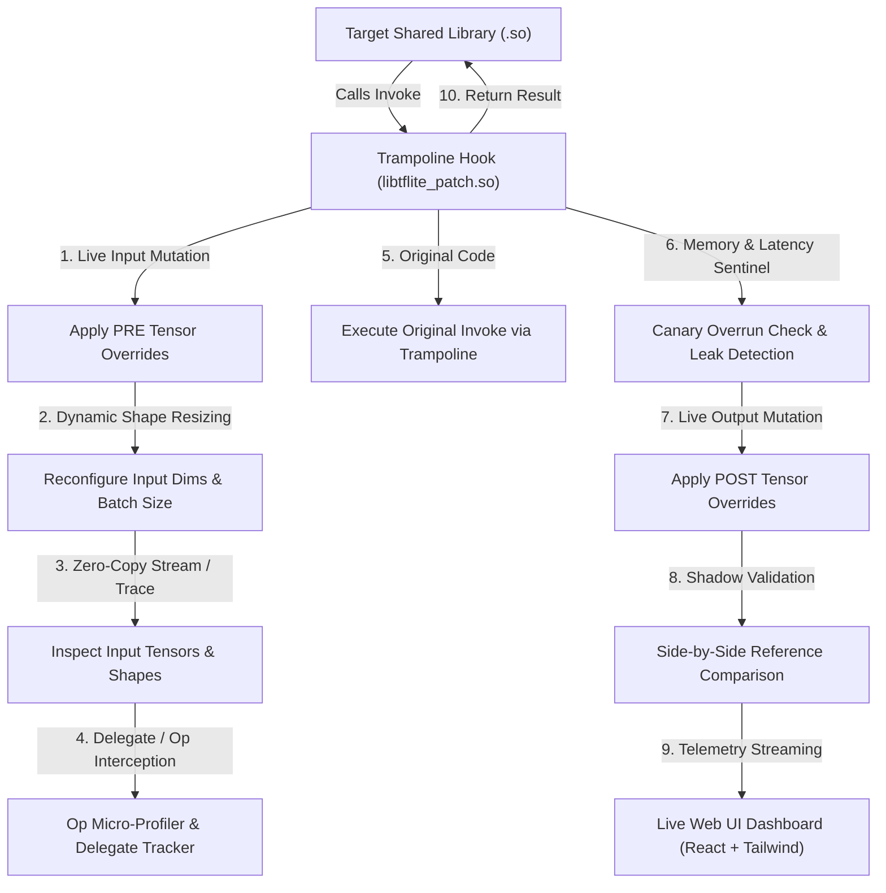

# patching_tflite: Generic TFLite Patching, Tracing & Mutation Framework

`patching_tflite` is a standalone, generic instrumentation and hooking framework designed to intercept, trace, profile, mutate, and dump TensorFlow Lite model inferences from **any** shared library (`.so`) running on Linux x86_64.

It is completely generic and can be attached to any shared library that embeds, statically links, or dynamically links TensorFlow Lite.

---

## Architecture & Features



### Complete Feature Set

1. **Live Web UI Dashboard (`tflite-patch ui`)**:
   - Modern dark-hard shadcn-style reactive dashboard built with **React, TypeScript, Tailwind CSS**, and managed with **pnpm**.
   - Real-time sliding window throughput and latency waterfall charts powered by Recharts.
   - Live 2D/3D tensor heatmap visualizer with interactive per-cell hover inspection.
   - Op-level latency breakdown chart and bottleneck detector.
   - Live Anomaly & Sentinel alert stream.
2. **Op-Level Micro-Profiling**:
   - Sub-graph operator latency breakdown (`Conv2D`, `DepthwiseConv`, `MatMul`, `Softmax`, etc.).
   - Pinpoints exact layer bottlenecks exceeding execution time thresholds.
3. **Hardware Acceleration & Delegate Tracking**:
   - Intercepts `TfLiteInterpreterModifyGraphWithDelegate`.
   - Tracks hardware offload percentage (GPU, NPU, DSP, Hexagon, NNAPI) vs CPU fallback.
4. **Dynamic Shape Resizing & Dynamic Batching**:
   - Runtime reconfiguration of input tensor dimensions and batch sizes without binary re-compilation.
5. **Shadow Execution Engine**:
   - Side-by-side lockstep verification of compiled `.so` inferences against reference PyTorch / LiteRT models.
   - Real-time statistical drift analysis: Cosine Similarity, MAE, RMSE, and Top-1 accuracy.
6. **Memory Safety Sentinel**:
   - Resident memory (RSS) leak detection across invocations.
   - Buffer boundary canary guard checking (`0xDEADBEEFFEEDFACE`) to detect memory corruption and buffer overruns.
7. **Live Tensor Injection / Mutation**:
   - Mutate input tensors before inference (`is_post=False`) to inject synthetic/adversarial data.
   - Override output tensors after inference (`is_post=True`) to mock downstream behavior.
8. **Zero-Copy In-Memory Python Callbacks**:
   - Real-time stream of tensor buffers directly into Python as shaped NumPy `ndarray` objects without disk I/O.
9. **Intermediate & Custom Op Layer Tracing**:
   - Trace all internal activation tensors across hidden layers (`trace_all_tensors=True`), or specify explicit custom layer tensor indices.
10. **Automatic `.so` Scanner (`scan_library` & CLI `tflite-patch scan`)**:
    - Inspects any shared library's ELF symbols (`.dynsym`, `.symtab`, `.rodata`), discovers TFLite C and C++ entry points, and recommends the optimal hooking mode.
11. **Embedded Model Extraction & FlatBuffer Netron Inspection**:
    - Extracts embedded `TFL3` `.tflite` model binaries from disk or memory for direct inspection.
12. **Record & Replay Sessions + Perfetto Tracing**:
    - Record full sessions to `.tflite_session` files, replay them offline, or export to Chrome Tracing / Perfetto JSON.

---

## Quick Start

### 1. Build the Native Hook

```bash
cd patching_tflite
make
```

### 2. Run Test Suite

```bash
make test
# Or:
python3 -m unittest discover -s tests -p "test_*.py" -v
```

14 unit tests verify trampoline lifecycle, live tensor mutation, in-memory streaming callbacks, intermediate op tracing, ELF scanning, latency profiling, and CLI commands.

---

## Python API Usage

### Live Tensor Mutation & Callbacks

```python
import numpy as np
from patching_tflite import TFLitePatcher, PatcherConfig

config = PatcherConfig(
    trace_path="/tmp/tflite_trace.log",
    trace_all_tensors=True,  # Trace all intermediate layers
)

with TFLitePatcher(config) as patcher:
    # 1. Register metadata
    patcher.register_model("my_model", tensor_count=4, inputs=[0], outputs=[3])

    # 2. In-memory live streaming callback (Zero-copy)
    def on_tensor(call_id, stage, model, sg_idx, tidx, name, dtype, shape, data, elapsed):
        print(f"[{stage}] Tensor #{tidx} shape={shape} dtype={dtype}")

    patcher.set_tensor_callback(on_tensor)

    # 3. Live tensor override before inference
    patcher.set_tensor_override(0, np.array([10.0, 20.0, 30.0, 40.0], dtype=np.float32), is_post=False)

    # 4. Attach hook to your target library
    patcher.install_hook_symbol("/path/to/library.so", "TfLiteInterpreterInvoke")

    # 5. Run inference as normal ...

    # 6. View performance analytics
    stats = patcher.get_profiling_stats()
    patcher.print_profiling_summary()
```

### Scanning a Shared Library

```python
from patching_tflite import scan_library

res = scan_library("/path/to/any_library.so")
print(res.summary())
print("Recommended Hook Symbol:", res.recommended_symbol)
print("Recommended Mode:", res.recommended_mode)
```

---

## Command Line Interface (CLI)

```bash
# 1. Scan any library for TFLite entrypoints
tflite-patch scan /path/to/library.so

# 2. Launch Live Web UI Dashboard
tflite-patch ui --port 8080 --demo

# 3. Wrap any execution with LD_PRELOAD and tensor dumping
tflite-patch run --lib ./libmodel.so --dump-dir ./dumps -- python my_app.py

# 4. Inspect generated tensor dump files
tflite-patch inspect-dump ./dumps/my_model_m001/call000001_POST_output_t00003_output.json
```

---

## Live Web UI Dashboard (`patching_tflite/ui`)

A high-performance reactive dashboard built with React 18, TypeScript, Tailwind CSS, and dark-hard shadcn aesthetic:

```bash
# 1. Install frontend dependencies with pnpm
cd patching_tflite/ui
pnpm install
pnpm approve-builds --all
pnpm build

# 2. Run the dashboard server
cd ..
tflite-patch ui --port 8080 --demo
```

Open `http://localhost:8080` in your browser. Real-time updates stream via Server-Sent Events (SSE).

---

## Native C API

Header: `include/tflite_patch.h`

| Function | Purpose |
|---|---|
| `install_invoke_hook_symbol(lib, sym)` | Hook exported symbol |
| `install_invoke_hook_address(addr)` | Hook virtual address directly |
| `install_invoke_hook_offset(base, off)` | Hook base + offset |
| `install_invoke_hook_relative(sym, off, tgt)` | Hook relative to anchor symbol |
| `remove_all_hooks()` | Restore original instructions |
| `set_tensor_override(model, is_post, idx, buf, sz)` | Live mutate input/output tensor memory |
| `clear_tensor_overrides()` | Remove all active overrides |
| `set_tensor_callback(cb)` | Register in-memory zero-copy callback |
| `clear_tensor_callback()` | Unregister callback |
| `set_trace_all_tensors(enabled)` | Trace all internal layer tensors |
| `set_custom_tensor_indices(arr, count)` | Trace specific tensor indices |
| `get_latency_profile(model, out)` | Retrieve P50/P90/P99 and anomaly statistics |
| `enable_tensor_dump(dir, filter)` | Dump tensors to `.bin` and `.json` |
